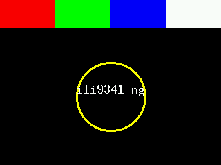

# Ilitek ILI9341 TFT LCD Controller

[](https://github.com/sunsided/ili9341/actions)
[](https://codecov.io/gh/sunsided/ili9341)

> Platform-agnostic Rust support for the Ilitek ILI9341 240×320 TFT LCD controller.



*The [ESP32-C3 example](https://github.com/sunsided/ili9341/tree/main/examples/esp32c3) in Wokwi, landscape orientation.*

| Crate                                        | Description                                                        |
|----------------------------------------------|--------------------------------------------------------------------|
| [`ili9341-registers`](ili9341-registers)     | The ILI9341 command set and parameter layouts.                     |
| [`ili9341-ng`](ili9341-ng)                   | An `embedded-hal` 1.0 driver (blocking and async, SPI and parallel). |
| [`ili9341-sim`](ili9341-sim)                 | A behavioral model of the controller for tests.                    |

## Emulation

The behavioral model in `ili9341-sim` decodes the command stream of the SPI and parallel
interfaces into a frame memory, and enforces the datasheet's reset and sleep timing.
It is used both in host tests of the driver and as a [Wokwi](https://wokwi.com) custom
chip ([`sim/wokwi-chip`](sim/wokwi-chip/README.md)). Unlike Wokwi's built-in ILI9341
part, the chip answers SPI reads and supports the parallel buses, 18-bit color,
scrolling and partial mode.

The example firmware in [`examples/esp32c3`](examples/esp32c3/README.md) runs against
both, using `wokwi-cli`: the drawing scenario on the built-in part and on the chip, and a
read-back scenario on the chip. Every [GitHub Release](https://github.com/sunsided/ili9341/releases)
carries the chip as `chip.zip`, for use with a `github:` dependency in `diagram.json`.

For the [Wokwi](https://wokwi.com) web editor, which no longer compiles Rust,
[`examples/arduino-esp32c3`](examples/arduino-esp32c3/README.md) draws the same picture
from an Arduino sketch with raw ILI9341 commands, on the built-in part or on the chip.

**[Try it in the browser](https://wokwi.com/projects/480785747677505537)**: an ESP32-C3 drawing on the emulated ILI9341 chip on
wokwi.com, and reading its display ID back.

## Development

The [Taskfile](Taskfile.dist.yaml) wraps the common commands: `task check` and
`task test` run what CI runs, `task sim` builds the ESP32-C3 firmware and runs the
drawing scenario. `task` lists everything.

## Releasing

Both published crates share one version. From `main`, with the changes listed under
`## [Unreleased]` in each crate's `CHANGELOG.md`:

```sh
cargo release <patch|minor|major>            # dry run
cargo release <patch|minor|major> --execute
```

This commits `Release X.Y.Z` and pushes the tag `vX.Y.Z`. The tag runs the release workflow,
which publishes `ili9341-registers` and `ili9341-ng` to crates.io via
[trusted publishing](https://crates.io/docs/trusted-publishing) (no API token in the
repository) and then creates a GitHub Release named `X.Y.Z` with the changelog sections
as notes.

Each GitHub Release carries the packaged `.crate` files with [build provenance attestations](https://docs.github.com/actions/security-for-github-actions/using-artifact-attestations).

## Code of Conduct

We abide by the [Contributor Covenant][cc] and ask that you do as well.

## License

Copyright © 2026 Markus Mayer

Triple licensed under your choice of either of:

- European Union Public Licence, Version 1.2, ([LICENSE-EUPL](LICENSE-EUPL)
  or https://joinup.ec.europa.eu/collection/eupl/eupl-text-eupl-12)
- Apache License, Version 2.0, ([LICENSE-APACHE](LICENSE-APACHE) or http://www.apache.org/licenses/LICENSE-2.0)
- MIT license ([LICENSE-MIT](LICENSE-MIT) or http://opensource.org/licenses/MIT)

[cc]: https://contributor-covenant.org
