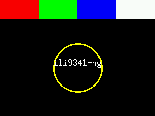

# Ilitek ILI9341 TFT LCD Controller Driver

[![Crates.io][crates-image]][crates-link]
[![Docs][docs-image]][docs-link]
[![Build Status][build-image]][build-link]
[![Safety Dance][safety-image]][safety-link]
![MSRV][msrv-image]
[![EUPL 1.2 licensed][license-eupl-image]][license-eupl-link]
[![Apache 2.0 licensed][license-apache-image]][license-apache-link]
[![MIT licensed][license-mit-image]][license-mit-link]

> A platform-agnostic driver for the Ilitek ILI9341 240×320 TFT LCD controller.



*The [ESP32-C3 example](https://github.com/sunsided/ili9341/tree/main/examples/esp32c3) in Wokwi, landscape orientation.*

Built on [`embedded-hal`] 1.0 and the [`ili9341-registers`] command map. Enable the `async`
feature for a driver on [`embedded-hal-async`], and `embedded-graphics` for a
`DrawTarget<Color = Rgb565>`. The package is `ili9341-ng`; the library is imported as
`ili9341_ng`.

```rust,ignore
use ili9341_ng::{Ili9341, Orientation, SpiInterface};

ili9341_ng::reset(&mut rst, &mut delay)?;
let mut display = Ili9341::new(SpiInterface::new(spi, dc)); // SpiDevice + D/C pin
display.init(&mut delay)?;                                   // RGB565, display on
display.set_orientation(Orientation::Landscape)?;
display.fill_screen(0x0000)?;
display.fill_rect(10, 10, 100, 50, 0xF800)?;                 // red, RGB565
```

For the 8080-I parallel bus, wrap the data pins and `WRX`:

```rust,ignore
use ili9341_ng::{GpioBus, ParallelInterface};

let bus = GpioBus::new([d0, d1, d2, d3, d4, d5, d6, d7]);   // or 16 pins
let mut display = Ili9341::new(ParallelInterface::new(bus, dc, wr));
```

`GpioBus` sets one pin at a time. For speed, implement `OutputBus` on a port register.

## Implemented so far

- 4-wire SPI, 8-bit and 16-bit 8080-I parallel interfaces
- Initialization with the Adafruit_ILI9341 power and gamma settings, hardware reset, sleep and display on/off with datasheet timing
- Four orientations, RGB/BGR color order, color inversion
- 16-bit (RGB565) and 18-bit (RGB666) color on every interface
- Area writes from pixel iterators, rectangle and screen fills, bounds checks
- Vertical scrolling with fixed top and bottom areas, partial mode
- Reading over SPI (needs `SDO` and at most 6.6 MHz): power mode, `MADCTL`, pixel
  format, self-diagnostic, display ID, and pixels from the frame memory
- `embedded-graphics` `DrawTarget`s for `Rgb565` and `Rgb666`, with clipping (blocking
  driver)
- Raw commands via `send_command` and the [`ili9341-registers`] types

Not implemented: reading over the parallel bus (it needs the `RDX` line and switching
the data lines to inputs), idle mode, tearing effect output.

```rust,ignore
// Scroll the middle of the panel; 20 fixed lines at the top and bottom.
display.set_scroll_area(20, 20)?;
display.set_scroll_start(20 + offset)?;

// Read back over SPI (needs SDO): pixels come as 6-bit [r, g, b].
let mut pixels = [[0; 3]; 4];
display.read_pixels_rgb666(0, 0, 2, 2, &mut pixels)?;
```

Scrolling and partial mode work on frame memory lines: the 320 lines along the long
side, whatever the orientation.

If colors look swapped or inverted on your module, call `set_color_order(ColorOrder::Rgb)`
or `set_inverted(true)` after `init`.

[`embedded-hal`]: https://crates.io/crates/embedded-hal
[`embedded-hal-async`]: https://crates.io/crates/embedded-hal-async
[`ili9341-registers`]: https://crates.io/crates/ili9341-registers

## License

Copyright © 2026 Markus Mayer

Triple licensed under your choice of either of:

- European Union Public Licence, Version 1.2, ([LICENSE-EUPL](LICENSE-EUPL)
  or https://joinup.ec.europa.eu/collection/eupl/eupl-text-eupl-12)
- Apache License, Version 2.0, ([LICENSE-APACHE](LICENSE-APACHE) or http://www.apache.org/licenses/LICENSE-2.0)
- MIT license ([LICENSE-MIT](LICENSE-MIT) or http://opensource.org/licenses/MIT)

[crates-image]: https://img.shields.io/crates/v/ili9341-ng
[crates-link]: https://crates.io/crates/ili9341-ng
[docs-image]: https://docs.rs/ili9341-ng/badge.svg
[docs-link]: https://docs.rs/ili9341-ng/
[build-image]: https://github.com/sunsided/ili9341/workflows/Rust/badge.svg
[build-link]: https://github.com/sunsided/ili9341/actions
[safety-image]: https://img.shields.io/badge/unsafe-forbidden-success.svg
[safety-link]: https://github.com/rust-secure-code/safety-dance/
[msrv-image]: https://img.shields.io/badge/rustc-1.85+-blue.svg
[license-eupl-image]: https://img.shields.io/badge/license-EUPL_1.2-blue.svg
[license-eupl-link]: https://joinup.ec.europa.eu/collection/eupl/eupl-text-eupl-12
[license-apache-image]: https://img.shields.io/badge/license-Apache_2.0-blue.svg
[license-apache-link]: https://www.apache.org/licenses/LICENSE-2.0
[license-mit-image]: https://img.shields.io/badge/license-MIT-blue.svg
[license-mit-link]: https://opensource.org/licenses/MIT
